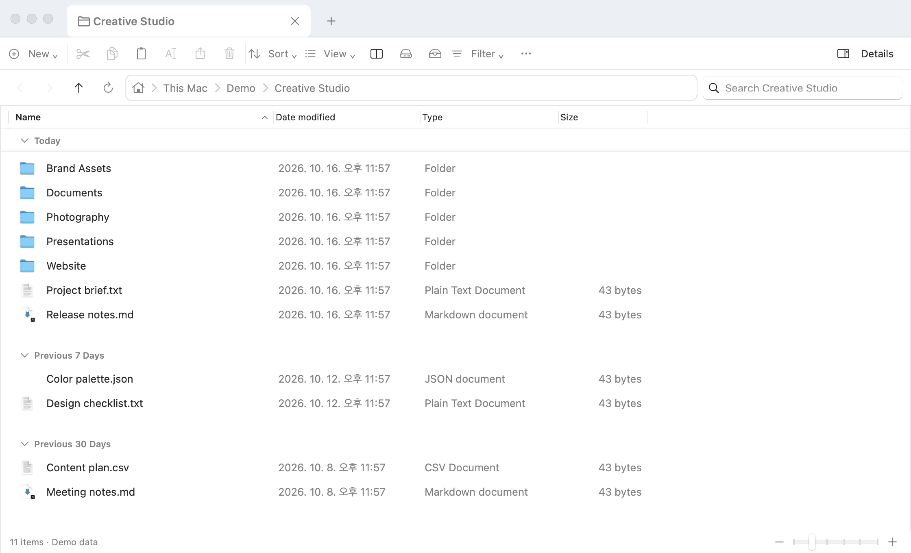
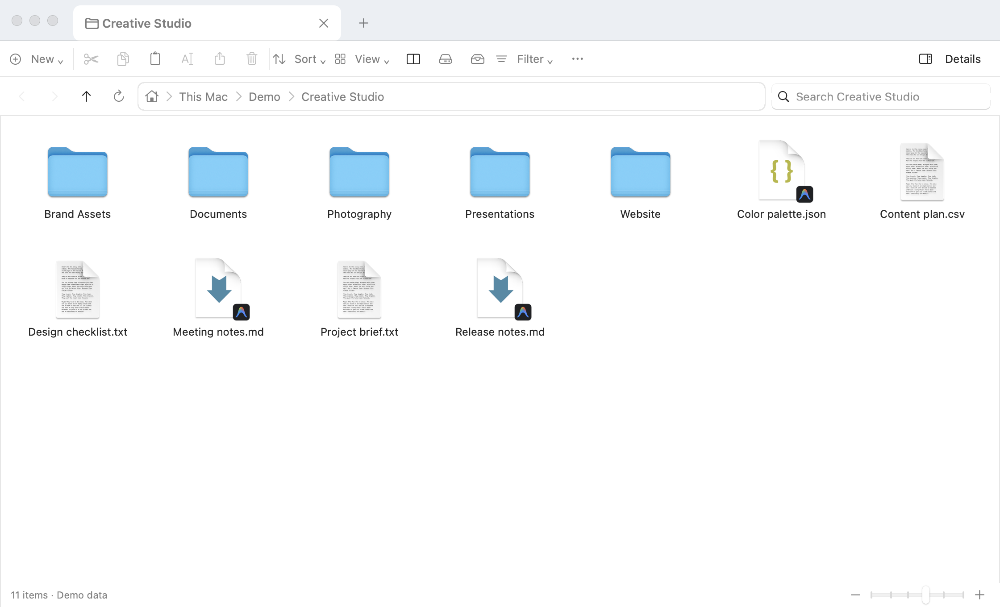
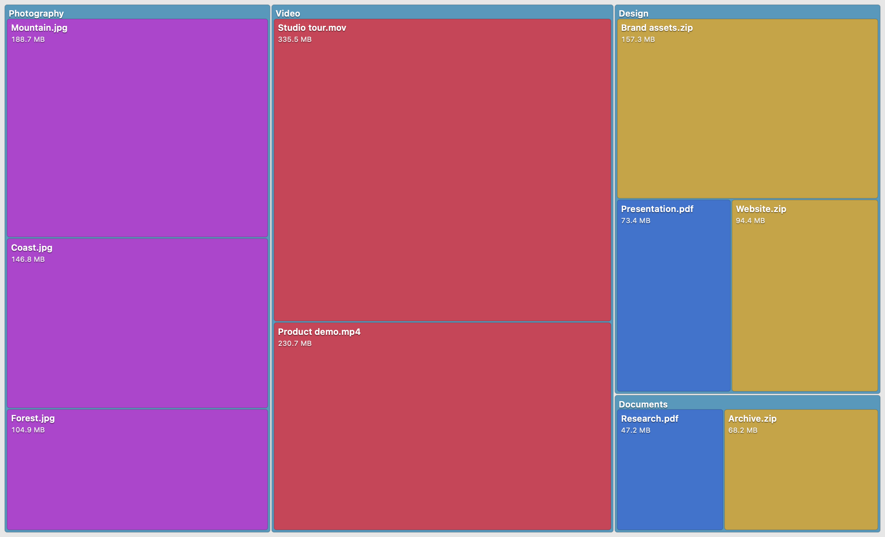

# Mac Explorer

Windows 탐색기에 익숙한 사용자를 위한 네이티브 macOS 파일 탐색기입니다. Swift와 AppKit으로 구현했으며, 현재 개발 중입니다.

## 주요 기능

- 탭·분할 화면, 즐겨찾기, 편집 가능한 경로 표시줄
- 목록·아이콘 보기, 날짜별 그룹, 검색·필터
- 복사·이동·이름 변경·실행 취소, 압축·해제
- Quick Look, 파일 정보, 필요할 때 계산하는 폴더 용량
- 용량 지도, 중복 파일 찾기, 사용자 지정 단축키
- 한국어·영어 등 다국어 지원
- 새 버전 알림과 앱 내 업데이트 설치·재실행

## 미리 보기

### 목록과 날짜 그룹



### 아이콘 보기



### 용량 지도



## 설치

[최신 릴리즈](https://github.com/RilakKuma2/Mac_file_explorer/releases/latest)에서 DMG를 다운로드하고, **Mac Explorer.app**을 **Applications** 폴더로 드래그하세요.

macOS 13 이상, Apple Silicon Mac을 지원합니다.

## 소스에서 설치

macOS 13 이상, Swift 6.x 및 Xcode Command Line Tools가 필요합니다.

```sh
swift test
./scripts/build-app.sh
open "dist/Mac Explorer.app"
```

빌드한 `dist/Mac Explorer.app`을 응용 프로그램 폴더로 옮겨 사용할 수 있습니다.

## 업데이트

새 버전이 있으면 알림에서 다운로드·설치를 선택할 수 있습니다. **Mac Explorer → 업데이트 확인…** 메뉴로 직접 확인할 수도 있습니다. 자동 확인은 같은 메뉴에서 끌 수 있습니다.

배포 방법은 [릴리즈 안내](docs/RELEASING.md)를 참고하세요.

## 라이선스

GNU General Public License v2.0 or later (`GPL-2.0-or-later`). 자세한 내용은 [LICENSE](LICENSE)를 참고하세요.

This program is free software: you can redistribute it and/or modify it under the terms of the GNU General Public License as published by the Free Software Foundation, either version 2 of the License, or (at your option) any later version.

This program is distributed in the hope that it will be useful, but WITHOUT ANY WARRANTY; without even the implied warranty of MERCHANTABILITY or FITNESS FOR A PARTICULAR PURPOSE. See the GNU General Public License for more details.
